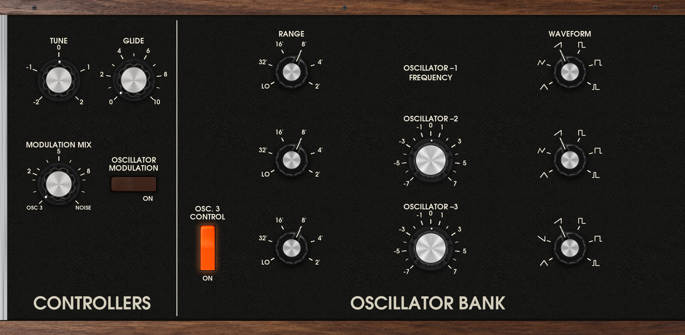
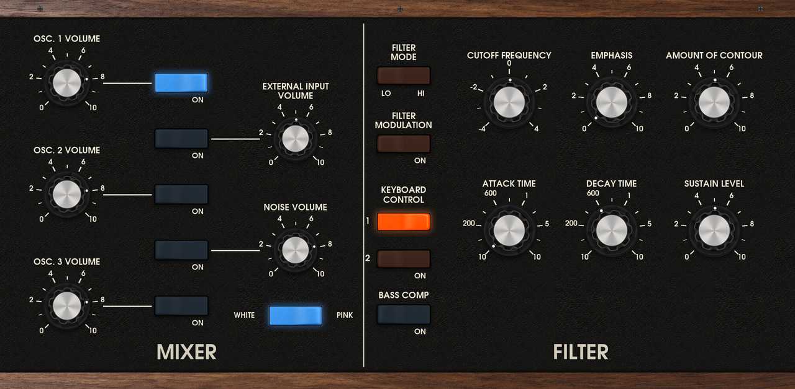
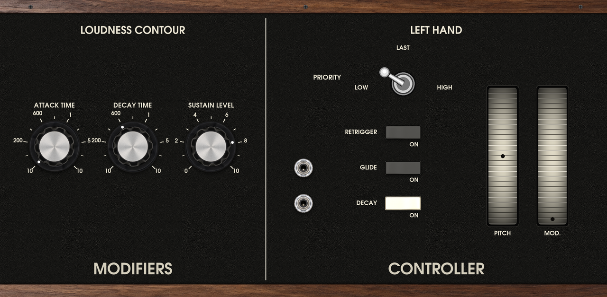
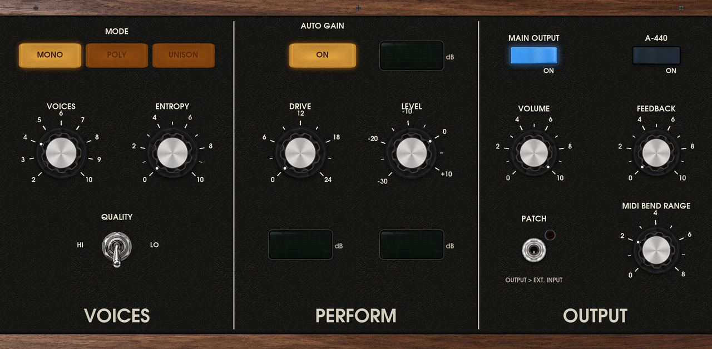
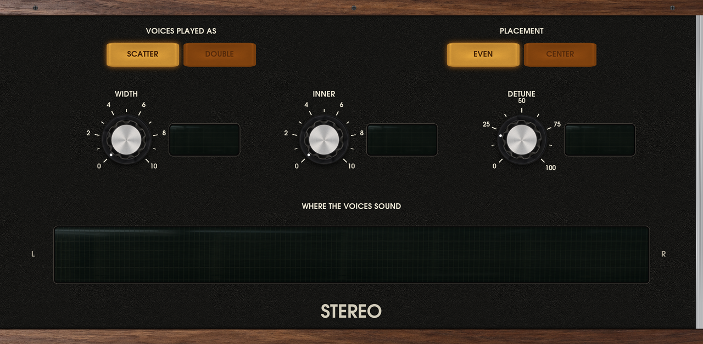

# Model-72

A homage to the 1970s Minimoog Model D as a native instrument for Akai MPC OS standalone devices
(Force, MPC Live / One / X / Key). It is [Idle Foundry's CA-72](https://github.com/idlefoundry/ca-72), a
circuit-modelled synthesizer, ported to MPC's own plugin host with a skin drawn from CA-72's panel, built on
[mpc-vst-plugins](https://github.com/sd88me/mpc-vst-plugins).

Model-72 is an unofficial port. It is not affiliated with or endorsed by Idle Foundry or Moog Music, and uses
neither company's name in the plugin. The sound models, panel art and factory presets are CA-72's
(GPL-3.0-or-later, Copyright 2026 Idle Foundry Ltd.); the MPC engine, skin tooling and mods are this repo's.

Status: running on a Force; sounds right, skin being finished. Not yet tested on the other MPC models.

## Screens

| | |
|---|---|
|  |  |
|  |  |
|  | |

Five tabs, drawn for the MPC's 1280 x 628 plugin area from CA-72's own pictures and typeface (`skin/`), each with its own
Q-Link bank: **OSCILLATORS** (controllers, oscillator bank), **MIXER** (the oscillators', external input's and noise's
levels and switches, then OUTPUT: VOLUME, MAIN OUTPUT, QUALITY, FEEDBACK, PATCH, A-440, BASS COMP), **MODIFIERS** (filter,
contours and the left-hand controller with its wheel), **PERFORM** (MODE, VOICES, ENTROPY, DRIVE, LEVEL, AUTO GAIN, BEND
RANGE) and **STEREO**. The wood, panel face and silver ends are the same on every tab, so they read as one panel continuing.
Every knob, selector and switch is a filmstrip, so it looks and turns as it does in CA-72. The STEREO tab's field shows where
the sounding voices sit, live.

## What plays

- **QUALITY LO**: CA-72's light model ("Potato mode"), its laws fitted to the circuit model. MONO, POLY (2 to 10
  voices) or UNISON, with ENTROPY, stereo, DOUBLE, DRIVE, LEVEL and AUTO GAIN. About 1.3 to 2.7 % of a Force core
  a voice.
- **QUALITY HI**: one voice. The light oscillators, mixer and contours drive the circuit's own filter (board 4's
  transistor ladder, solved in real time, and its control node) in place of the light filter. It stays within
  0.2 to 0.6 dB of CA-72's full circuit model on most patches (third-octave bands), and the filter self-oscillates
  in tune to within a cent. About 30 to 55 % of a Force core. CA-72's full circuit voice takes 73 to 130 % of one
  Force core and does not run in real time there, so it is not included.

Stereo (WIDTH, INNER, DETUNE, SCATTER / DOUBLE, EVEN / CENTER) works as in CA-72, in LO. DOUBLE is off in HI (it
would need a second circuit filter). Not ported: LOCK, MIDI Learn, a track's audio into EXTERNAL INPUT, and AUTO
GAIN's per-sound measurement (CA-72's average curve stands in, as it does there until a sound is measured).

## Mods (not the instrument's)

- **BASS COMP**: raises the filter's input with resonance, so the bass holds as EMPHASIS rises. At EMPHASIS 8 the
  bass below the cutoff measured about -17 dB with it against -30 dB without, on both filters. DRIVE is different:
  it raises the input by a fixed amount whatever the resonance.
- **PATCH** (tap the PHONES jack on MODIFIERS): a cable from the output into EXTERNAL INPUT, the classic feedback
  mod. FEEDBACK sets how much; EXTERNAL INPUT's switch and VOLUME are in its path, as CA-72 models it.

## Presets

CA-72's 19 factory presets are in the plugin header's PRESET menu and as MPC preset files (`Presets/*.xpl`), with an
Instruments-browser tile. Stereo, DOUBLE and FEEDBACK settings come across; Feedback Funk turns PATCH on.

## Installing

1. Copy the `sd88me - VST - Model-72` folder to `/sdcard/Synths/` (or any `Synths` folder MPC scans).
2. Register it: stop MPC, add the plugin's line (`vst/build/pluginlist-entry.xml`) before `</KNOWNPLUGINS>` in
   `MPC.settings`'s `pluginList-arm` entry (back the file up first), start MPC.
3. Plugin list on a track: Model-72.

A release zip with an installer is planned (`tools/release.py` in mpc-vst-plugins); see its docs.

## Building

Needs Docker and a checkout of mpc-vst-plugins next to this repo (or `MPC_VST=`):

    vst/build.sh                                                  # engine, plugin, skin, presets -> vst/build/
    $MPC_VST/tools/test_port.sh vst/vst.json                      # offline host test (ASan)
    tools/make_skin.sh                                            # redraw the skin art (committed in vst/art/)
    python3 tools/presets.py json                                 # after editing vst/presets/factory.toml

The engine tests: `cargo test --release -p ca72-mpc` in `engine/` (the `engine/Dockerfile` image has the toolchain).

## Layout

| | |
|---|---|
| `engine/ca72/` | CA-72's real-time model, vendored; `src/light.rs` is the only file changed (`engine/VENDORED.md`) |
| `engine/ca72-mpc/` | The MPC engine: voices, MODE, ENTROPY, stereo, AUTO GAIN, the stereo field; fitting and bench examples |
| `skin/` | Draws the skin: CA-72's pictures and typeface, laid out for the MPC (`skin/README.md`) |
| `vst/` | Plugin definition (`vst.json`, `params.json`), skin layout, art, presets, build script |
| `tools/` | Parameter table and preset converters |

## Licence

GPL-3.0-or-later, as CA-72 is (`LICENSE`). Model-72 contains CA-72's source and its pictures; the lettering is URW Gothic
(AGPL-3.0 with a font exception, `skin/assets/URW-LICENSE`).
