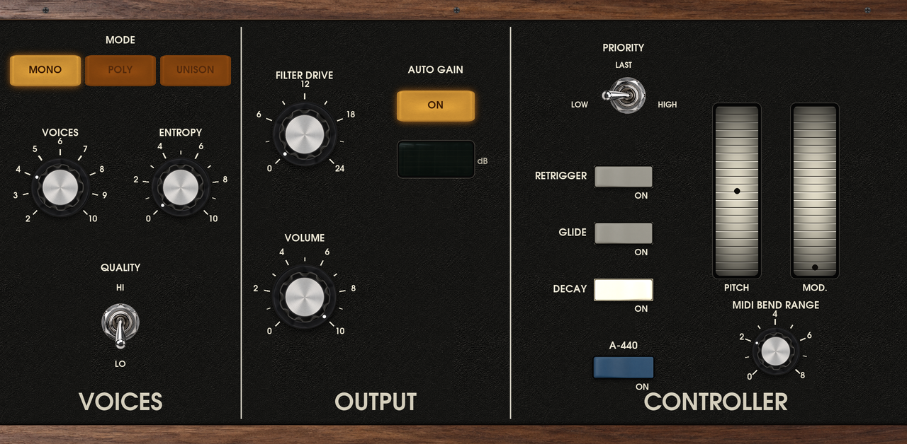

# Model-72

**A circuit-modelled 1970s monosynth for Akai MPC and Force**, with a skin of its own.

Model-72 is a port of [**CA-72**](https://github.com/idlefoundry/ca-72), Idle Foundry's free, open-source software
model of the Minimoog Model D (about 1972-73, the CA3046 "old" oscillator board). CA-72's sound is derived from the
instrument's own circuit: every board was transcribed from its service documents into SPICE netlists and simulated,
the real-time models were derived from those simulations and tested against them, and the result was calibrated
against a hardware instrument. It is an exceptionally accurate and excellent-sounding digital emulation, and it is the
reason this plugin exists.

Model-72 puts that engine on the MPC's own plugin host, as a native plugin with a skin drawn for the MPC's screen, and
makes it run in real time on the MPC's CPU. It runs standalone on MPC OS (Force, MPC Live / One / X / Key; Gen1 and Gen2
builds), with no computer and no other software.

> Model-72 is an unofficial, independent port. It is **not affiliated with or endorsed by Idle Foundry Ltd. or Moog
> Music Inc.** "Minimoog" is a trademark of Moog Music Inc., used here only to say what CA-72 models. The plugin's name
> and skin carry neither company's name or logo.

## Screens

Four tabs, drawn for the MPC's 1280 x 628 plugin area from CA-72's own pictures and typeface, each with its own Q-Link
bank. The wood, panel face and silver ends are the same on every tab, so they read as one panel.

| | |
|---|---|
| **OSCILLATORS**: controllers and the oscillator bank | **MIXER FILTER**: the mixer, PATCH, the filter and the loudness contour |
|  |  |
| **OUTPUT**: output, voices and the left-hand controller | **STEREO**: width, inner, detune and the live field |
|  |  |

Every knob, selector and switch is a filmstrip, so it looks and turns as in CA-72; the switches are bright when on and
dim when off. The STEREO tab's field shows where the sounding voices sit, live.

## Performance and accuracy: the hybrid approach

CA-72's full circuit voice is too heavy for an MPC: it takes 73 to 130 % of a Force core for **one** voice, so it cannot
run in real time there. CA-72 also has a "light" model (its Potato mode), whose laws are fitted to the circuit model.
Model-72 uses both, as a switch:

- **QUALITY LO**: CA-72's light voice. MONO, POLY (2 to 10 voices) or UNISON, with ENTROPY, stereo, DOUBLE, DRIVE and
  AUTO GAIN. About **1.3 to 2.7 % of a Force core per voice**, so a full chord or a ten-voice unison fits comfortably.
- **QUALITY HI**: one voice, the **hybrid**. The light oscillators, mixer and contours drive the *circuit's own filter*:
  board 4's transistor ladder, solved in real time, through its real control node, in place of the light filter. The
  filter is where the character is, and that is where the CPU goes. In measurements it stays within **0.2 to 0.6 dB** of
  CA-72's full circuit model on most patches (third-octave bands), and the filter self-oscillates in tune to within a
  cent. It costs **30 to 55 % of a Force core**. The constants that join the two models were fitted against the full
  circuit (`engine/ca72-mpc/examples/fit.rs`, `compare.rs`). DOUBLE is off in HI (it would need a second circuit filter).

The circuit filter is built on a thread when the plugin loads (the first build takes about 12 s on a Force); LO plays
straight away. All CPU figures were measured on a Force (Gen1) with the bench in mpc-vst-plugins; the Gen2 builds have
only run offline so far.

## Features

- **The whole instrument**: three oscillators (range, waveform, frequency), the mixer with external input and noise
  (white or pink), the filter and both contours, glide, the modulation wheel and pitch bend, FILTER MODE, keyboard
  control, NOTE PRIORITY, RETRIGGER, A-440, as on CA-72's panel.
- **MONO, POLY or UNISON**, 2 to 10 voices, **ENTROPY** (every voice a little different, as every real instrument is).
- **Stereo**: WIDTH, INNER, DETUNE, SCATTER / DOUBLE, EVEN / CENTER, and a live display of where the voices sit.
- **FILTER DRIVE**, **AUTO GAIN** (with a readout of its correction) and **VOLUME**.
- **19 factory presets** from CA-72, in the plugin header's PRESET menu and as MPC preset files, with a browser tile.
- **Two mods that are not the instrument's:**
  - **BASS COMP**: raises the filter's input with resonance so the bass holds as EMPHASIS rises (at EMPHASIS 8 the bass
    below the cutoff measured about -17 dB with it against -30 dB without, on both filters). It is not DRIVE, which raises
    the input by a fixed amount whatever the resonance.
  - **PATCH**: cables the output into EXTERNAL INPUT, the classic feedback mod. EXTERNAL INPUT VOLUME sets how much;
    patching turns that input on. Feedback Funk uses it.
- Quality, mode and all settings are Q-Link controls and are saved with the project.

Not ported from CA-72: LOCK, MIDI Learn, a track's audio into EXTERNAL INPUT, and AUTO GAIN's per-sound measurement
(CA-72's average curve stands in, as it does there until a sound is measured).

## Installing

Download the zip for your device from the [releases](https://github.com/sd88me/mpc-vst-model72/releases):

| Device | Zip |
|---|---|
| Force, MPC Live, One, X, Key (**Gen1**, 32-bit ARM) | `Model-72-<version>-mpc-armv7.zip` |
| MPC Live III and kin (**Gen2**, 64-bit ARM) | `Model-72-<version>-mpc-aarch64.zip` |

Unpack it and follow its `INSTALL.md` (the zip's `install.sh` copies the plugin to the device's `Synths` folder and
registers it in `MPC.settings`, with a backup). Restart MPC; the plugin is **Model-72** in a track's plugin list. Skins
load at MPC's start, so any later skin change needs another restart.

Status: running on a Force, where it has been played and its CPU measured. The Gen2 build passes the offline test but
has not been run on a Gen2 device, and Gen2 has no SSH route this project provides. Reports from Gen2 owners are welcome.

## Building

Needs Docker and a checkout of [mpc-vst-plugins](https://github.com/sd88me/mpc-vst-plugins) next to this repo (or
`MPC_VST=`):

    vst/build.sh                                  # engine, plugin, skin, presets -> vst/build/ (armv7 and aarch64)
    $MPC_VST/tools/test_port.sh vst/vst.json      # offline host test (ASan); add `aarch64` for the Gen2 build
    tools/make_skin.sh                            # redraw the skin art (committed in vst/art/)
    python3 tools/presets.py json                 # after editing vst/presets/factory.toml

Engine tests: `cargo test --release -p ca72-mpc` in `engine/` (the `engine/Dockerfile` image has the toolchain).

| | |
|---|---|
| `engine/ca72/` | CA-72's real-time model, vendored; `src/light.rs` is the only file changed (`engine/VENDORED.md`) |
| `engine/ca72-mpc/` | The MPC engine: voices, MODE, ENTROPY, stereo, AUTO GAIN, the stereo field; fitting and bench examples |
| `skin/` | Draws the skin from CA-72's pictures and typeface for the MPC (`skin/README.md`) |
| `vst/` | Plugin definition, skin layout and art, presets, build script |
| `tools/` | Parameter-table, preset and skin scripts |

## Licence and credits

**Model-72 is free software under the GNU General Public License, version 3 or later** (`LICENSE`), as CA-72 is. The
complete corresponding source of every release is this repository at its tag. The plugin is a combined work: you may
use, study, change and share it under those terms.

| Part | Author | Licence |
|---|---|---|
| **CA-72**: the circuit and light models, the sound, the factory presets, the stereo and voice-character code (`engine/ca72/`, `engine/ca72-mpc/src/character.rs`, `stereo.rs`, `vst/presets/`) | Copyright 2026 **Idle Foundry Ltd.** ([ca-72](https://github.com/idlefoundry/ca-72), commit `3f99076`, 0.2.0; stereo placement from [plugin-kit](https://github.com/idlefoundry/plugin-kit) `4c0f0f3`) | GPL-3.0-or-later |
| **Panel pictures**: the face, walnut, knobs, rockers, toggles, jack, jewel, button and glass (`skin/assets/*.png`) | Idle Foundry Ltd., from CA-72 | GPL-3.0-or-later |
| **Lettering**: URW Gothic Book and Demi (`skin/assets/`) | URW++ Design & Development | AGPL-3.0 with a font exception (`skin/assets/URW-LICENSE`) |
| **The MPC port**: `engine/ca72-mpc` (hybrid HI voice, voices and modes, AUTO GAIN, BASS COMP, PATCH, the field), the changes to `light.rs`, the skin generator and layouts, tools | sd88me, with Claude (Anthropic) | GPL-3.0-or-later |
| **MPC plugin wrapper** (VST2 host interface, skin and installer tooling) | [mpc-vst-plugins](https://github.com/sd88me/mpc-vst-plugins), sd88me | MIT |
| `libm` (Rust, statically linked) and Rust's standard library | The Rust project | MIT / Apache-2.0 |

`THIRD-PARTY-NOTICES.txt` has the notices. Model-72 contains no Moog Music or Idle Foundry trademarks or logos beyond the
attribution above. "VST" is a trademark of Steinberg Media Technologies GmbH; the plugin uses MPC's own plugin
interface and carries no Steinberg code.

If you like this, the thanks belong first to Idle Foundry for CA-72 and for releasing it as free software.
